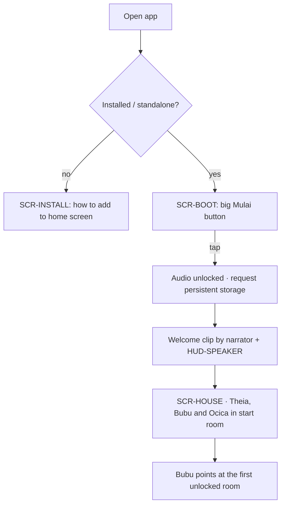
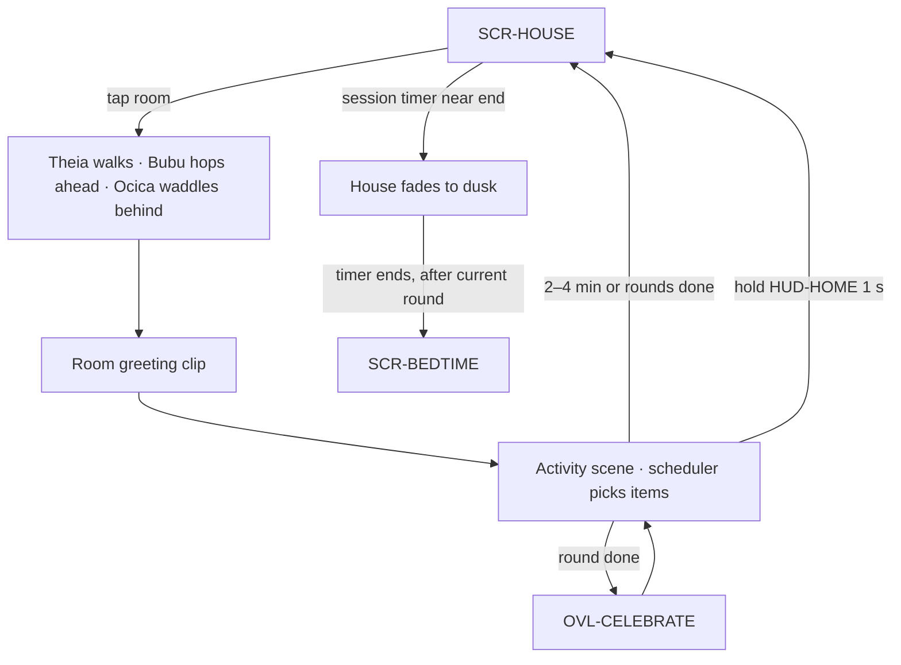
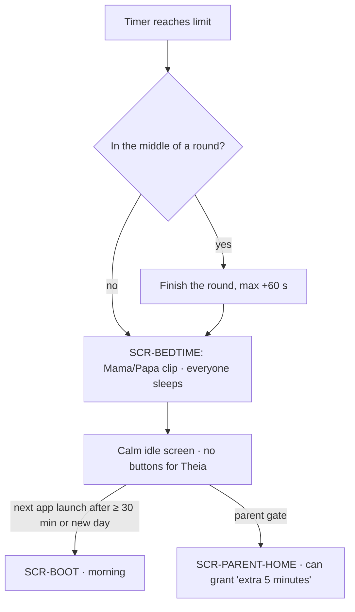
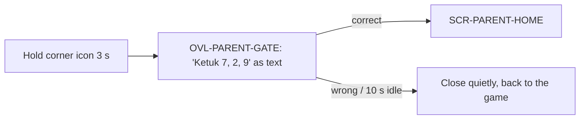

# Rumah Cici Theia — Product Requirements Document

| | |
|---|---|
| Status | **Draft, in review**. Gate 1 for M0 and M1 ([`WORKFLOW.md`](WORKFLOW.md)). |
| Author | Claude (architect and core developer) |
| Reviewers | Papa (approver), Mama |
| Scope | Full product vision. **M0 and M1 are specified in detail.** M2–M4 are outlined and get their own addendum in `docs/prd/` before their Phase 1. |
| Background | [`PLAN.md`](PLAN.md) (why), [`ARCHITECTURE.md`](ARCHITECTURE.md) (how), [`ASSETS.md`](ASSETS.md) (visual contract) |

How to review:
- Comment on any line in the PR.
- Mark disagreement with acceptance criteria especially. Those become the tests in Phase 4.
- Questions for the parents are in §13.

---

## 1. Problem and opportunity

Theia is 3. She knows her numbers and some letters, and she loves her dolls Bubu and Ocica. Most
learning apps for her age are a poor fit:
- They're in English, or in Indonesian that doesn't sound like home.
- They're built around ads, streaks, and endless play.
- They punish mistakes with buzzers.
- They have nothing to do with her own world.

**Rumah Cici Theia** puts her inside her own house with her own dolls. Her parents' voices guide
her, so practice feels like playing at home. The sessions are short, she never fails, and the
game ends naturally at bedtime.

## 2. Goals and non-goals

### Goals
- **G1**: Build pre-writing and writing motor skills: strokes → digits → lowercase → uppercase.
- **G2**: Build number sense for 1–10: counting objects one by one, "how many altogether",
  recognising small groups at a glance, matching numbers to quantities.
- **G3**: Build early literacy in Bahasa Indonesia: letter recognition and sounds → syllables →
  words (M2+).
- **G4**: Make it something she *wants* to come back to, without manipulative mechanics.
- **G5**: Give the parents visibility and control (progress, session length, voice), without
  needing the developer.

### Non-goals
- Not a general children's app. One child, one family, and it is never published to a store.
- No text-to-speech, no generated voices, no chat, no AI at runtime.
- No accounts, no cloud progress sync until M4 (and only if needed), no multiplayer.
- No monetization, ads, analytics, notifications, or external links.
- Not a replacement for paper, crayons, or reading together. The session limit exists to protect
  that time.

## 3. Personas

| Persona | Who | Needs | Constraints |
|---|---|---|---|
| **Theia**, the player | 3 years old, knows her numbers and some letters, plays on her own | Instant feedback, familiar voices and faces, big things to touch, success she can feel | Can't read. Attention lasts about 3–5 minutes per activity. Taps imprecisely. Rests her palm on the screen. May press anything. |
| **Mama**, narrator and co-reviewer | Records most of the voice lines. Reviews PRDs and concepts. | Recording in short batches, seeing what Theia practised | Reviews mainly on her phone (GitHub mobile app) |
| **Papa**, product owner | Approves gates, merges PRs, manages devices and deployment | Gates that take minutes to approve, a clear rollback | — |

Bubu, Ocica, Mama, and Papa also appear as **in-game characters**. They are not personas.

## 4. Success metrics

Measured in **playtests**, observed by a parent using the protocol in §11. The game has no
analytics.

| ID | Metric | M1 target |
|---|---|---|
| SM1 | Plays a full session on her own after a parent starts it | 3 of the first 5 sessions |
| SM2 | Asks to play again on another day, without being prompted | At least once in the first week |
| SM3 | Frustration incidents: crying, throwing the device, "can't do it" plus quitting | 0 per session on average, never more than 1 |
| SM4 | Stops at bedtime without a fight | 4 of 5 sessions |
| SM5 | Progress: pre-writing strokes and digits that reach mastery box ≥ 3 | ≥ 50% of the M1 set after 2 weeks |
| SM6 | Transfer: tries a practised stroke or digit on paper | Observed at least once |

**Guardrails**, which the product must never break:
- A session never runs past the parent-set limit plus 1 minute.
- No sound or animation that signals "failure".

## 5. Scope by milestone

| Milestone | Scope | Detail in |
|---|---|---|
| **M0 Foundations** | Repo, CI/CD, Cloudflare Workers + Access, installable offline shell, audio unlock, placeholder renderer, contracts v1, **tracing spike on the tablet**, reference tooling | §8.1 |
| **M1 First playable** | House hub with 3 rooms. Tap-to-walk. Bubu and Ocica follow. Tracing T0 (pre-writing strokes) and T1 (digits 0–9). Counting C1–C4 for 1–5. Tap-to-fill coloring with 5 pages. Speaker portraits. Voice clips. Session timer and bedtime. Basic parent area. Storage and export. | §8.2 |
| M2 Letters | Lowercase then uppercase tracing (Theia's letters first), letter recognition and sounds, stickers, outfits, full parent dashboard, spaced repetition | `docs/prd/M2.md` (later) |
| M3 Reading | Syllables and words, counting to 10 and adding, remaining rooms, Mama and Papa full-body sprites | `docs/prd/M3.md` (later) |
| M4 Extras | Garden (shapes, colors, memory), brush coloring, printable worksheets, optional sync | `docs/prd/M4.md` (later) |

## 6. Screen inventory

| ID | Screen / overlay | Audience | M |
|---|---|---|---|
| `SCR-INSTALL` | "Install this app" help shown when opened in a browser tab instead of the installed app | Parent | M0 |
| `SCR-BOOT` | Big "Mulai" button. Unlocks audio, then the welcome. | Theia | M0 shell, M1 art |
| `SCR-HOUSE` | Cutaway house hub: rooms, Theia, Bubu, Ocica, day and night | Theia | M1 |
| `SCR-TRACE` | Tracing activity: Lihat → Ikuti → Titik-titik steps | Theia | M0 spike, M1 |
| `SCR-COUNT` | Counting activity: variants C1–C4 | Theia | M1 |
| `SCR-COLOR-PICK` | Choose a coloring page (2–3 big thumbnails) | Theia | M1 |
| `SCR-COLOR` | Tap-to-fill coloring | Theia | M1 |
| `SCR-BEDTIME` | Session-end ending: Theia, Bubu, and Ocica go to sleep | Theia | M1 |
| `HUD-HOME` | Hold-to-go-home button, shown in every activity | Theia | M1 |
| `HUD-SPEAKER` | Speaker portrait (Mama or Papa) with a talking mouth while a clip plays | Theia | M1 |
| `OVL-CELEBRATE` | Short celebration after an activity round | Theia | M1 |
| `OVL-RECOVER` | Neutral "oops, let's go home" animation after an internal error | Theia | M1 |
| `OVL-PARENT-GATE` | Hold the corner for 3 s, then tap 3 numbers shown as text | Parent | M1 |
| `SCR-PARENT-HOME` | Parent area: progress summary, links to settings and data | Parent | M1 (basic), M2 (full) |
| `SCR-PARENT-SETTINGS` | Session length, narrator, Theia's name, tracing tolerance, case order | Parent | M1 |
| `SCR-PARENT-DATA` | Export and import progress JSON, reset, storage status, log export | Parent | M1 |

## 7. User flows

### 7.1 First launch (installed app)

### 7.2 Normal session

### 7.3 Session end and the next launch

### 7.4 Parent gate

### 7.5 Error recovery
An uncaught error in a scene logs a structured entry, shows `OVL-RECOVER` for about 2 s, and
returns to `SCR-HOUSE`. If the hub itself fails, the app reloads to `SCR-BOOT`. Theia never sees a
blank or frozen screen.

## 8. User stories and acceptance criteria

The IDs are stable. Phase 4 E2E tests use these IDs as test names
(`WORKFLOW.md` §4, Phase 4).

### 8.1 M0: Foundations

**US-OFF-01: Install and offline play.** As Papa, I install the app on the tablet and Theia can
play without internet.
- Given the app has been opened online once, when the device is offline and the app is launched
  from the home screen, then `SCR-BOOT` loads in < 3 s and the placeholder house is playable.
- Given it was opened in a normal browser tab, then `SCR-INSTALL` shows the install steps instead
  of the game.

**US-AUD-01: Audio starts on the first tap.**
- Given a fresh launch, when Theia taps "Mulai", then the welcome clip starts within 300 ms.
- No sound plays before that tap, and no voice clip ever overlaps another.

**US-PRIV-01: Nothing leaves the device.**
- During a full session, the browser makes **zero** requests to origins other than the app's own.
- The build output contains no file from `reference/` or `recordings/`. CI checks this.

**US-DEP-01: Private deployment and rollback.**
- The production URL and every preview URL require a family Google account (Cloudflare Access).
- `wrangler rollback` restores the previous version. The installed app runs it after its next cold
  start, and existing progress still loads.

**US-TRACE-00: Tracing spike.** As Papa, I can judge on the real tablet whether finger tracing
feels right before any art is drawn.
- The spike offers one vertical stroke, a circle, and the digit **1**, in Follow mode.
- Input-to-ink latency is < 30 ms (measured with Chrome remote debugging).
- Palm and second-finger touches don't draw.
- Tolerance can be adjusted live in a debug panel.
- **Exit:** Papa (and Theia, informally) confirm it feels right. Otherwise tracing is reworked
  before M1 design starts.

**US-REF-01: Reference tooling.**
- `npm run reference:check` lists missing reference items against `ASSETS.md` §1.2.
- `npm run reference:frames` extracts key frames from videos into `reference/frames/`.

### 8.2 M1: First playable

#### House hub
**US-HOUSE-01: Walk to a room.**
- When Theia taps anywhere inside an unlocked room's area, then her character walks there along
  the waypoint path (through doors, up stairs) and the room's activity starts on arrival.
- A tap on another room while walking re-routes from her current position.
- A tap outside every room does nothing, and Bubu tilts its head.
- Tap areas are ≥ 72 dp everywhere.

**US-HOUSE-02: Companions.**
- Bubu hops ahead of Theia and Ocica waddles behind her.
- On arrival in a room, both play their idle animation near her.
- When a room has something new or something due for review, Bubu goes and **points** at it
  after 5 s without a tap, and repeats every 20 s at most.

**US-HOUSE-03: Locked rooms.**
- Rooms outside M1 look dim and sleepy, with no padlock.
- Tapping one plays a soft "zzz" sound and Ocica yawns. No voice says "locked".

**US-HOUSE-04: Day turns to night.**
- The light in the house moves continuously from morning to dusk as the session goes on.
- The last 2 minutes are dusk, which gives Theia a visual heads-up before bedtime.

**US-HOUSE-05: Phone layout.**
- On the phone (2400 × 1080), the house is wider than the screen: the camera follows Theia and
  she can drag to pan.
- On the tablet the whole house fits on screen.
- Tap areas never shrink below 72 dp on either device.

#### Tracing (bedroom, T0 + T1)
**US-TRACE-01: Watch first.**
- When a new item starts, the voice names it and Bubu's paw draws it stroke by stroke ("Lihat").
- Then the "Ikuti" step starts automatically. Nothing needs to be tapped.

**US-TRACE-02: Follow the ball.**
- In "Ikuti" (Follow mode), a ball sits at the start of the current stroke.
- The ball moves forward only while Theia's finger is inside the tolerance corridor ahead of it.
- Lifting her finger keeps the progress. Touching again near the ball continues the stroke.
- When a stroke is done, it snaps onto the ideal path and sparkles, and the next stroke appears.

**US-TRACE-03: Dotted step.**
- After 2 successful "Ikuti" completions of an item, it moves to "Titik-titik" (Score mode).
- A stroke passes when it meets the age-3 thresholds (`ARCHITECTURE.md` §4.3).
- A failed stroke fades out gently, the demo replays for that stroke only, and Ocica comforts her.
- After 3 failed strokes in a row, the game falls back to "Ikuti" for that stroke. She is never
  stuck.

**US-TRACE-04: Content and order.**
- T0 strokes are offered first: vertical, horizontal, circle, diagonal, cross, zigzag, wave.
- T1 digits 0–9 unlock when ≥ 80% of T0 items reach box ≥ 3, or when a parent unlocks them.
- A round has 3 items: due-for-review items first, then a new one, then one easy win
  (`ARCHITECTURE.md` §5).

**US-TRACE-05: Only one finger draws.**
- Only the first touch draws. Other touches, including a resting palm, are ignored.
- Strokes still register on the phone's smaller screen. The tracing area takes the full height.

**US-TRACE-06: Tolerance adapts.**
- The tracing tolerance adapts within its limits from her results on the last 10 strokes.
- A parent override in settings replaces the adaptive value.

#### Counting (kitchen, C1–C4, 1–5)
**US-COUNT-01: Count along (C1).**
- N objects appear (N = 1–5). Each tap on an object highlights it and the voice says the next
  number.
- Tapping an object that's already counted does nothing, so it can't be counted twice.

**US-COUNT-02: How many altogether (C2).**
- After counting, the voice asks "Berapa semuanya?" and shows 3 numeral choices.
- The right answer: celebration, and Ocica munches a cookie.
- A wrong answer: Bubu recounts with her, then she gets another try. After 3 misses the game shows
  the answer and moves on.

**US-COUNT-03: Recognise a small group (C3).**
- A dot pattern for 1–5 appears for 2 s. She picks the matching picture group from 3 options.
- The display time never runs below 1.5 s, and the dots come back on request (tap the speaker
  portrait).

**US-COUNT-04: Put N in the bowl (C4).**
- "Masukkan empat telur ke mangkuk": she drags or taps objects into the bowl, and the voice counts
  each one.
- One too many: the extra object hops back out on its own, with no "wrong" sound.
- The right count: the bowl glows and the celebration plays.

**US-COUNT-05: Number range.** M1 covers 1–5 only. The range is a config value, so 1–10 needs no
code change.

#### Coloring (living room)
**US-COLOR-01: Choose a page.** `SCR-COLOR-PICK` shows the unlocked pages as 2–3 big thumbnails.
Tapping one opens it.

**US-COLOR-02: Tap to fill.**
- She taps a color swatch: the voice says its name (*merah*, *kuning*, …).
- She taps an area of the picture: it fills with that color instantly.
- Tapping a line or a tiny gap does nothing. Fill never leaks outside the area.

**US-COLOR-03: Save and show.**
- Pages are saved automatically.
- A finished page (≥ 80% of its areas filled) appears on the fridge in the house.
- Reopening a page shows her colors.
- One-step undo with an "oops" button that is ≥ 96 dp.

**US-COLOR-04: Unlocks.**
- M1 ships 5 pages. 2 are unlocked at the start.
- One more unlocks each time a tracing item reaches box ≥ 3, until all 5 are open.

#### Voice and characters
**US-VOICE-01: Narrator.**
- Instructions use the narrator setting: **Mama by default**, Papa, or alternating by room.
- If a clip is missing, the other parent's version plays. If both are missing, a soft chime plays,
  so a voice cue is never silent.
- Praise mixes Mama's and Papa's clips.

**US-VOICE-02: Speaker portrait.**
- While a voice clip plays, the speaker's portrait (`HUD-SPEAKER`) shows in a corner, and its mouth
  moves with the clip's loudness.
- Tapping the portrait replays the last instruction. This is how Theia asks "what was it again?"

**US-VOICE-03: No overlaps.** One voice clip at a time. A new instruction cancels any queued praise.
Music ducks while a voice clip plays.

#### Session and bedtime
**US-SESSION-01: Session limit.**
- Default 10 minutes, set by a parent (5–20).
- When time runs out, she finishes the current round (max +60 s), and then the bedtime ending
  plays.

**US-SESSION-02: Bedtime ending.**
- Theia, Bubu, and Ocica go to bed in her room. The narrator says goodnight.
- After that, a calm idle screen has nothing for Theia to tap.
- The next playable session needs a new app launch ≥ 30 minutes later, or a new day, or a parent
  granting 5 more minutes.

**US-SESSION-03: Go home.**
- `HUD-HOME` must be **held for 1 s**, with a filling ring, so a stray tap doesn't leave the
  activity.
- Holding it walks her back to the house.

#### Parent area (basic)
**US-PARENT-01: Gate.**
- Holding the corner icon for 3 s opens a keypad with a text prompt: "Ketuk 7, 2, 9", with the
  numbers random each time.
- A wrong entry or 10 s of no input closes it quietly.

**US-PARENT-02: Progress summary.**
- Shows time played today and this week.
- Shows each T0 stroke, T1 digit, and counting level with its mastery box (1–5).
- Shows the last 3 tracing attempts per item as replays.

**US-PARENT-03: Settings.** These take effect on the next round:
- session length
- narrator
- Theia's name and her written name **Theia**
- tracing tolerance override
- case order (lowercase-first is the default, used from M2)
- manual unlock of T1

**US-PARENT-04: Data.**
- Export progress as JSON. Importing validates the JSON and refuses invalid files with a clear
  message.
- Reset needs a second confirmation.
- Shows whether persistent storage was granted.
- Exports the log ring buffer.

## 9. Content scope for M1

| Area | Items |
|---|---|
| Strokes (T0) | `stroke.vertical` (hujan), `stroke.horizontal` (jalan), `stroke.circle` (bola), `stroke.diagonal` (perosotan), `stroke.cross` (tanda tambah), `stroke.zigzag` (petir), `stroke.wave` (ombak) |
| Digits (T1) | `num.0`–`num.9`, stroke order per Indonesian school practice |
| Counting | Objects: `telur`, `apel`, `kue`, `bola`, `ikan`. Containers: `mangkuk`, `piring`. Range 1–5. |
| Coloring | 5 pages, each one subject tied to a future letter word: e.g. `ayam`, `bola`, `ikan`, `kucing`, `susu` (final list in the design brief) |
| Rooms | 3 rooms. Draft mapping: Theia's bedroom → tracing, kitchen → counting, living room → coloring. Final mapping once the floor plan is in. |
| Voice | About 110 clips per voice (`AUDIO.md` §2). Mama records the whole set. Papa records praise and greetings at minimum. |

## 10. Non-functional requirements

| ID | Requirement |
|---|---|
| NFR-PERF-01 | 60 fps on the family tablet. Tracing input-to-ink < 30 ms. Room transition < 1 s after the first visit. |
| NFR-PERF-02 | First load ≤ 3 MB. Each room bundle ≤ 4 MB. Atlases ≤ 2048². |
| NFR-OFF-01 | Every M1 feature works fully offline after the first online launch. Updates apply on the next cold start only. |
| NFR-REL-01 | No blank or frozen screen. Every error is logged as structured JSON and recovered from (§7.5). |
| NFR-DATA-01 | Progress survives app updates and rollbacks (additive schema). Export and import round-trip without loss. |
| NFR-PRIV-01 | No third-party requests. No photos or raw recordings in git or in the build. Access-protected hosting. Strict CSP. |
| NFR-COMPAT-01 | Current stable Chrome on the family's Android tablet and phone (models to confirm, §13). Landscape only, installed fullscreen. |
| NFR-UX-01 | Touch targets ≥ 72 dp (≥ 96 dp for primary actions). No text-only instructions for Theia. No failure sounds. No timers she can see. |
| NFR-MAINT-01 | Engine code has unit tests. Every acceptance criterion has an E2E test. Design artifacts are validated against `contracts/`. |

## 11. Playtest protocol

- **When**: end of Phase 4 for each milestone, and 1–2 extra sessions during Phase 3 if a build is
  stable.
- **Setup**: tablet, app pinning on, Do Not Disturb, a parent sitting nearby but **not helping**
  unless she asks twice.
- **Observe and note** in `docs/handoff/M<n>-playtest.md`:
  - which room she picks first
  - where she hesitates for > 5 s
  - anything she taps that isn't interactive
  - each frustration incident (SM3)
  - whether the bedtime ending was accepted (SM4)
  - anything she said, quoted
- **After the session**: ask her two questions: "Apa yang paling seru?" and "Mau main lagi?" Write
  down her answers word for word.
- **Rule**: a finding that blocks SM1, SM3, or SM4 is a **blocker** for the milestone.

## 12. Dependencies on the parents

| Input | Needed for | By |
|---|---|---|
| Google Drive reference folder set up and mirrored. `reference` symlink created. | Everything visual | Start of M0 |
| Floor plan sketch + room photos | House layout, room mapping | Before M1 Phase 2 |
| Photos of Theia, Mama, and Papa. Photos and 360° videos of Bubu and Ocica. | Character and family sheet | Before M1 Phase 2 |
| Family tablet and phone models + Android versions | NFR-COMPAT-01, device tests | M0 |
| Voice recording sessions (Mama full set, Papa praise and greetings) | M1 audio | During M1 Phase 3 |
| Cloudflare account + domain decision | US-DEP-01 | M0 |

## 13. Open questions

1. What do the voice lines call her: "Cici", "Theia", or "Cici Theia"? The examples use "Cici".
2. Which exact tablet and phone models (and Android versions) does the family use?
3. Domain: a subdomain of an existing personal domain, or the default `*.workers.dev`? Access works
   with both.
4. Sound effects (Bubu and Ocica sounds, UI, music): is the proposal OK? Claude curates CC0 sounds
   with a license log, and Antigravity approves the fit.
5. Is 10 minutes the right default session length, and is the 30-minute cooldown before the next
   session right?
6. Should the parent be able to turn off the bedtime cooldown entirely, for a holiday or a long car
   ride?
7. Coloring page subjects for M1: any favourites (her own toys, family pets, foods)?

## 14. Out of scope (all milestones)

- Accounts, multiple children, or any public distribution (Play Store, public URL)
- Generated content at runtime (TTS, AI images, AI chat)
- Leaderboards, competition, timers she can see, or any "fail" state
- Devices other than the family's Android phone and tablet. iOS and desktop are not tested.

## 15. Approval (Gate 1)

- [ ] Papa approves this PRD, by approving the PR
- [ ] Mama has reviewed it
- [ ] The M1 design brief (`docs/handoff/M1-design-brief.md`) covers every M1 screen in §6
- [ ] Antigravity has acknowledged contracts v1 (follow-up PR) with no blocking questions
- [ ] The tracing spike (US-TRACE-00) feels right on the tablet
