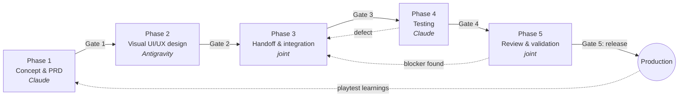

# Rumah Cici Theia — Delivery Workflow

How the two AI agents and the parents take each milestone from idea to production.
[`../AGENTS.md`](../AGENTS.md) holds the day-to-day rules. This file defines the **phases, gates, and
handoffs**.

---

## 1. Actors

| Actor | Role | Responsible for |
|---|---|---|
| **Claude** (Claude Code) | Architect & core developer | PRD, architecture, contracts (schemas), game logic, integration, refactoring, tests, CI/CD, code review |
| **Antigravity** | UI/UX designer & prototyper | Visual direction, design system, characters, house, screen designs, motion, clickable prototype, presentational UI components, all production visual assets |
| **Papa** (with Mama) | Product owner & approver | Decisions, reference photos, voice recordings, playtests with Theia, **approving every gate**, merging PRs |

The agents never talk directly. Everything passes through the repo (handoff docs, issues, PRs),
and Papa routes and approves.

## 2. Phases and milestones

The roadmap in [`PLAN.md`](PLAN.md) §8 is split into **milestones M0–M4**. The **5 phases** below
are the process each milestone goes through:



- **Phase 1 runs once in depth** for the whole product, during M0. It produces the master PRD.
  Each later milestone gets a short PRD addendum.
- **Phases 2–5 repeat for each milestone**, starting with M1. Building the whole game in a single
  design pass and only then testing it with a 3-year-old is the most expensive mistake this
  project could make.
- **Phases overlap where it's safe.** While Antigravity designs (Phase 2), Claude builds the engine
  logic on code-generated placeholders (§4.2b). Integration in Phase 3 then wires in real art
  instead of starting from scratch.

## 3. Shared artifacts and ownership

| Path | Owner | Contents |
|---|---|---|
| `docs/PRD.md`, `docs/prd/M*.md` | Claude | Master PRD and per-milestone addenda |
| `docs/handoff/` | Whoever writes the handoff | One file per handoff (§6) |
| `contracts/` | **Claude drafts, Antigravity co-signs** | Schemas as code (zod + generated JSON Schema): asset manifest, layout, tokens, motion, UI component props |
| `design/tokens.json` | Antigravity | Colors, typography, spacing, radii, touch-target sizes, shadows, z-layers |
| `design/layouts/<screen-id>.json` | Antigravity | Where every element on a game screen sits: key, position, anchor, depth, hit area. Defined per device class. |
| `design/motion.json` | Antigravity | Timings and easings for every transition, celebration, and hint |
| `design/mockups/` | Antigravity | Approved screen mockups, tablet and phone. Also the visual baselines. |
| `assets/` | Antigravity | Production art (see [`ASSETS.md`](ASSETS.md)) |
| `ui/` | Antigravity | **Presentational** Svelte components for the parent area and the HUD: props in, events out, no logic |
| `prototype/` | Antigravity | Clickable prototype. Same stack as the game, mock data, never shipped. |
| `src/`, `tools/`, `tests/`, CI | Claude | Everything with behavior |

**The key handoff decision:** the prototype is never copied and rewritten. Phase 2 outputs are
files the game reads **as they are**:
- `tokens.json` becomes CSS variables and TS constants at build time.
- Layout JSON files are loaded by the game scenes.
- `motion.json` drives the tweens.
- `ui/` components are imported into `src/`, and Claude wires them to logic.

After launch, Antigravity can adjust a layout, a color, or a timing without touching `src/`, and
Claude can refactor logic without breaking the visuals.

Rules for `ui/` components, enforced by lint and reviewed by Claude for code quality:
- No imports from `src/`, no storage, no network, no global state.
- Typed props and events, matching `contracts/ui.ts`.
- Styles use tokens only. No hard-coded colors or sizes.
- Each component has a gallery entry in `prototype/` showing all of its states.

## 4. The phases

### Phase 1: Conceptualization and PRD (Claude)

**Inputs:**
- `PLAN.md`, `ARCHITECTURE.md`, and the parents' decisions
- Reference material in `reference/` (gitignored)

**Steps:**
1. **PRD** (`docs/PRD.md`):
   - Goals and non-goals
   - Personas: Theia (3 y.o.), Mama and Papa as parent users
   - Success metrics. These are playtest-based, for example "finishes a 10-minute session on her
     own" or "asks to play again the next day".
2. **User stories with acceptance criteria** in Given/When/Then form. Each one gets an ID
   (`US-TRACE-03`), so tests and reviews can trace back to it.
3. **Screen inventory**: every screen and overlay, with an ID (`SCR-BOOT`, `SCR-HOUSE`,
   `SCR-TRACE`, `OVL-PARENT-GATE`, …) and the milestone it belongs to.
4. **User flows**: mermaid diagrams for the first launch, a normal session, session end and
   bedtime, the parent gate, and error recovery.
5. **Design brief** (`docs/handoff/M<n>-design-brief.md`). For each screen in the milestone:
   - its purpose
   - every element, and its states (idle, active, success, hint, locked, loading)
   - its interactions
   - which text is rendered by the game and which pictures are art
   - voice cue timing
   - touch-target minimums, safe areas for tablet and phone
6. **Contracts v1** (`contracts/`): the schemas for manifest, layout, tokens, motion, and UI props.
   Antigravity reviews these at the Phase 2 kickoff.
7. **Technical foundation (M0 only)**:
   - repo scaffold and CI pipeline
   - placeholder renderer that draws any manifest key at the right size
   - schema validators
   - a **tracing spike on the real Android tablet**. Tracing is the riskiest mechanic, so it gets
     proven before any art is drawn.

**Gate 1 (Papa approves):**
- [ ] The PRD and its stories are approved.
- [ ] The design brief covers every screen in the milestone.
- [ ] Antigravity has acknowledged the contracts: no blocking questions left in the brief's Q&A
  section.
- [ ] (M0 only) The tracing spike feels right on the tablet.

### Phase 2: Visual UI/UX design (Antigravity)

**Inputs:**
- The design brief
- The contracts
- `reference/` photos: Theia, Mama, Papa, Bubu, Ocica, the house and the floor plan

**Steps**. The first time through, in M1, every step runs. Later milestones extend what exists.
1. **Style exploration**: 2–3 visual directions (a mood board plus one sample screen each). Papa
   picks one. *(M1 only.)*
2. **Character and family sheet**: Theia, Mama, Papa, Bubu, and Ocica at relative scale
   (`ASSETS.md` §3).
3. **House**: the cutaway house art plus `layout.json` (`ASSETS.md` §4).
4. **Design system**:
   - `tokens.json`
   - the UI component set in `ui/`: buttons, swatches, speaker portrait frame, sticker,
     progress display, parent-gate keypad
   - a component gallery in `prototype/`
5. **Screen designs**: a mockup for every screen in the milestone, in every state, at tablet
   (1920 × 1080) and phone (2400 × 1080) sizes. Exported to `design/mockups/<screen-id>/`.
6. **Motion spec**: `motion.json` plus short reference videos or GIFs for the key moments (walk
   start and stop, stroke snap, celebration, Ocica comfort, day-to-night fade).
7. **Clickable prototype** (`prototype/`): runs with `npm run proto`. Covers the milestone's main
   flow on mock data, so Papa can try it on the tablet.
8. **Production assets**: final exports in `assets/` per `ASSETS.md`, registered in the
   manifest.

**Phase 2b, in parallel (Claude):** engine work against the contracts, using placeholders:
- tracing scorer
- scheduler
- nav graph
- audio queue
- session timer
- storage

Unit tests are written alongside.

**Gate 2 (Papa approves, Claude checks the contracts):**
- [ ] Papa has tried the prototype on the tablet and approved it.
- [ ] Claude's **handoff review**:
  - `npm run validate:design` and `validate:assets` pass: schemas, sizes, closed coloring pages,
    atlas limits.
  - `ui/` follows the component rules in §3.
- [ ] The handoff doc lists every artifact delivered and every known gap (§6).

### Phase 3: Handoff and refinement / integration (joint)

**Steps:**
1. **Handoff**. Antigravity writes `docs/handoff/M<n>-design-handoff.md`. Claude replies in the same
   file with questions. The open questions are resolved before integration starts.
2. **Integration (Claude)**, one screen at a time, in the PRD's priority order:
   - Load the layout JSON, swap placeholders for manifest keys, and apply the motion spec.
   - Import the `ui/` components and wire them to logic and events.
   - Tag each screen as integrated in the milestone tracking issue.
3. **Refinement loop**. When integration shows a problem (an atlas over budget, a hit area too
   small on the phone, frames that don't loop, colors unreadable on the real screen), Claude files
   a `type:design-change` issue with a screenshot. Antigravity fixes it in `design/`, `assets/`,
   or `ui/`. Neither agent edits the other's files to work around a problem.
4. **Design QA in context**. Antigravity reviews each integrated screen from the preview build (the
   CI screenshots, or a local `npm run preview`) and files `type:visual-defect` issues.

**Gate 3:**
- [ ] Every screen in the milestone is integrated.
- [ ] No open `blocker` issues.
- [ ] CI is green.
- [ ] The preview deploy runs on the tablet and the phone.

### Phase 4: Testing (Claude)

| Layer | What | Tooling |
|---|---|---|
| Unit | Engine: tracing scorer (recorded-stroke fixtures), scheduler, nav, flood fill, session timer, storage migrations | Vitest |
| Component | `ui/` components in every state, events fire with the right payloads | Vitest + Svelte Testing Library |
| E2E | **At least one test for each acceptance criterion**, using the story ID as the test ID. Includes first launch, session to bedtime, parent gate, export/import. | Playwright, tablet and phone viewports, touch |
| Visual regression | Screenshot of every screen and state, compared to the baselines approved in Phase 5 | Playwright `toHaveScreenshot` |
| Offline & update | Install, go offline, play a full session, push an update, apply it on next launch only | Playwright + Workbox test mode |
| Privacy | Assert **zero** requests to any origin besides our own. No photos or raw recordings in the build output. | Playwright request log, build-output scan |
| Device | Real tablet and phone: fps, tracing input latency, memory, audio unlock, install, app pinning | Chrome remote debugging, checklist in `docs/handoff/M<n>-device-test.md` |
| Playtest | Theia plays, and a parent observes using the PRD success metrics (protocol in the PRD) | Parent notes in `docs/handoff/M<n>-playtest.md` |

There is a **traceability matrix** (`docs/handoff/M<n>-traceability.md`): story → acceptance
criterion → test → result.

**Gate 4:**
- [ ] All tests are green, and every acceptance criterion has a test that passes.
- [ ] The device checklist passes on both devices.
- [ ] The playtest is done. Any finding that changes the design opens a story for this milestone
  (blocker) or the next one.

### Phase 5: Review and validation (joint)

| Reviewer | Scope | Output |
|---|---|---|
| **Claude** | Whole-flow review against the PRD: every story is demonstrable. Code review of the milestone diff, conformance to the architecture, security (CSP, Access, no third-party calls), performance budgets (`ARCHITECTURE.md` §10), logging and error recovery. | Findings with severity |
| **Antigravity** | Visual fidelity: CI screenshots on both viewports vs. the approved mockups, animation timings vs. `motion.json`, consistency against the family sheet, the asset checklist (`ASSETS.md` §8). **Approves the visual-regression baselines.** | Findings with severity, baseline sign-off |
| **Papa** | Final look on the real devices, the playtest outcome | Release decision |

Both reviews go into `docs/handoff/M<n>-review.md`:
- **Blocker** findings send the milestone back to Phase 3.
- **Major** findings are fixed before the release or deferred with Papa's agreement.
- **Minor** findings go into the next milestone's backlog.

**Gate 5 (release):**
- [ ] No open blockers.
- [ ] Both reviewers have signed off.
- [ ] Papa merges the release PR. CI deploys to production. The release is tagged `v0.<n>.0`.

**Rollback:** `wrangler rollback <version-id>` to the previous version. The installed app picks it
up on its next cold start. Progress data survives because the schema only changes additively
(`ARCHITECTURE.md` §8.4).

## 5. Tracking

- **GitHub milestone** for each M. One **tracking issue** per milestone, containing every gate
  checklist above.
- Labels:
  - `phase:1-prd`, `phase:2-design`, `phase:3-integration`, `phase:4-testing`, `phase:5-review`
  - `owner:claude`, `owner:antigravity`, `owner:parents`
  - `type:story`, `type:design-change`, `type:visual-defect`, `type:defect`, `type:contract-change`
  - `blocker`
- Branches: Claude uses `feat|fix|chore|docs|test/…`, Antigravity uses `design/…`, `assets/…`,
  `ui/…`. One concern per PR.
- **Review rights:** each agent reviews the other's PRs within its own expertise. Claude reviews
  code quality and contract conformance of `ui/` and the design JSON. Antigravity reviews the visual
  result of Claude's integration PRs. Neither edits the other's files.

## 6. Handoff documents

Each one is a short markdown file in `docs/handoff/` with the same skeleton:

```markdown
# M1 — <handoff name>
From: <actor> → To: <actor> · Date · Gate: <n>

## Delivered        — artifact list with paths
## Decisions made   — and why
## Known gaps       — what is missing or placeholder, with an issue link
## Questions        — numbered; the receiver answers inline
## Sign-off         — [ ] receiver · [ ] Papa
```

| Handoff | From → To | When |
|---|---|---|
| `M<n>-design-brief.md` | Claude → Antigravity | Gate 1 |
| `M<n>-design-handoff.md` | Antigravity → Claude | Gate 2 |
| `M<n>-traceability.md`, `M<n>-device-test.md`, `M<n>-playtest.md` | Claude / parents → all | Gate 4 |
| `M<n>-review.md` | Claude + Antigravity → Papa | Gate 5 |

## 7. Contract changes

Contracts are the one place both agents depend on, so changes follow a strict procedure:
1. Whichever agent needs the change opens a `type:contract-change` issue with the reason and the
   proposed schema diff.
2. Claude implements the change in `contracts/` and bumps the schema version. The validators
   accept the old and new versions during the transition.
3. Antigravity migrates its files. Claude migrates its code.
4. The old version is removed once both sides have migrated. Papa approves the PR that removes it.

## 8. Risks in the workflow itself

| Risk | Mitigation |
|---|---|
| The agents drift apart, with art that doesn't fit the code or code that assumes art that doesn't exist | Contracts as code, plus validators in CI. Placeholders use the same keys and sizes. Gate 2 includes a contract check. |
| Design is finished before anyone learns how Theia actually plays | A loop per milestone, a playtest in every Phase 4, and a tracing spike before any art exists |
| The prototype becomes a second codebase | The prototype only *uses* the shipped artifacts (tokens, layouts, `ui/`, assets). It contains no logic worth keeping, and it never ships. |
| Papa becomes a bottleneck | Each gate is a single checklist. Agents prepare everything so approving takes minutes, and Papa can approve on the tablet. |
| Antigravity can't open the preview behind Cloudflare Access | Design QA uses the CI screenshot artifacts or a local `npm run preview`, so it needs no Access login |
| Private photos leak through an agent | `reference/` is gitignored, CI scans the build output, and the rule appears in both agents' instruction files |
